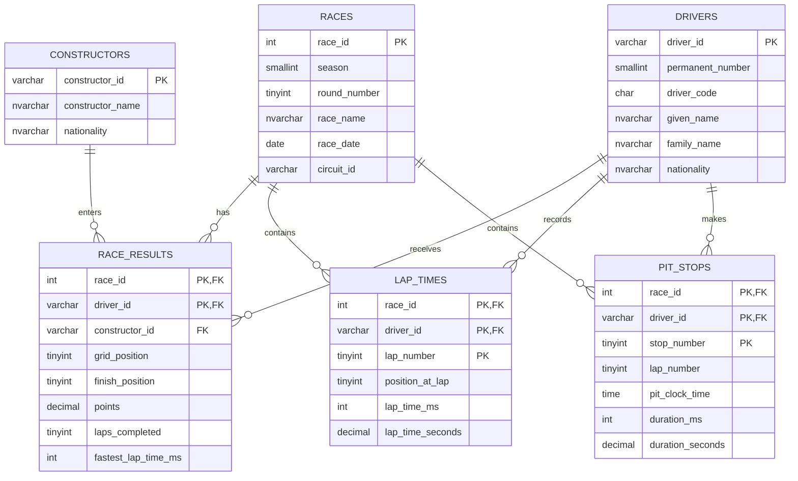

# Entity relationship diagram

This diagram shows the six tables in the `f1` schema and how their primary and foreign keys connect. It deliberately shows the main analytical fields rather than every column; the complete definitions are in [the data dictionary](data-dictionary.md) and [`01_create_tables.sql`](../sql/setup/01_create_tables.sql).

## How to read it

- `||` means exactly one parent row.
- `o{` means zero or many related child rows.
- `PK` identifies a primary-key column.
- `FK` identifies a foreign-key column.
- A column marked `PK, FK` is part of a composite primary key and also links to a parent table.

For example, one driver can have many lap-time rows, but each lap-time row belongs to exactly one driver. The combination of `race_id`, `driver_id` and `lap_number` uniquely identifies a lap.
